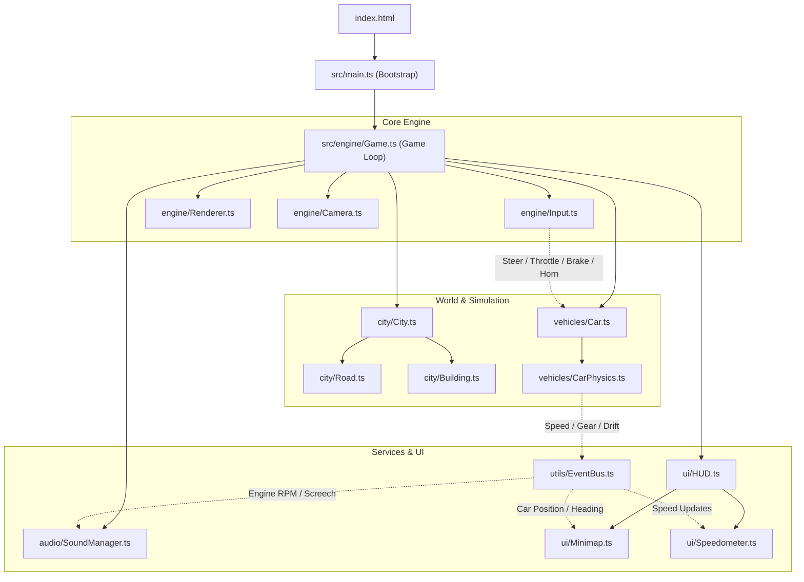

# Architecture Document — GTA 7 🏛️

## Architecture Overview

GTA 7 uses a modular, event-driven architecture built on top of Three.js. Systems are decoupled through an `EventBus`, allowing vehicle physics, rendering, UI, audio, and city generation to evolve independently.



---

## Directory Structure

```
gta7/
├── .github/
│   └── workflows/
│       ├── ci.yml            # CI: Lint, Vitest, Security, Build
│       └── deploy.yml        # CD: GitHub Pages automated deployment
├── docs/
│   ├── PRD.md                # Product requirements & roadmap
│   ├── ARCH.md               # System architecture
│   ├── SPEC.md               # Physics equations & specifications
│   └── SDLC.md               # Development & branching guide
├── src/
│   ├── main.ts               # Entry point
│   ├── engine/
│   │   ├── Game.ts           # Master game loop & state manager
│   │   ├── Renderer.ts       # Three.js scene, lights, antialiasing, fog
│   │   ├── Camera.ts         # Chase camera with spring damper
│   │   └── Input.ts          # Keyboard & gamepad input tracker
│   ├── city/
│   │   ├── City.ts           # City generator, district blocks
│   │   ├── Road.ts           # Road mesh generator with lane markings
│   │   └── Building.ts       # Procedural skyscraper & house generator
│   ├── vehicles/
│   │   ├── Car.ts            # 3D Vehicle model, wheels, headlights
│   │   └── CarPhysics.ts     # Arcade driving physics & kinematics
│   ├── ui/
│   │   ├── HUD.ts            # HUD container, star rating, notifications
│   │   ├── Minimap.ts        # Dynamic 2D top-down radar
│   │   └── Speedometer.ts    # Analog/digital speed & gear display
│   ├── audio/
│   │   └── SoundManager.ts   # Web Audio procedural synthesis
│   ├── utils/
│   │   ├── Constants.ts      # Tuning variables & configs
│   │   └── EventBus.ts       # Type-safe pub/sub event bus
│   └── __tests__/
│       ├── physics.test.ts   # Unit tests for vehicle physics
│       ├── city.test.ts      # Unit tests for city grid coordinates
│       └── game.test.ts      # Unit tests for game initialization
├── index.html                # Canvas container & styling
├── package.json              # Dependencies & npm scripts
├── tsconfig.json             # TypeScript configuration
├── vite.config.ts            # Vite bundler configuration
└── Makefile                  # Developer quick commands
```

---

## Key Design Patterns

1. **Decoupled Simulation & Presentation**: Physics calculations run at delta-time steps. The visual car mesh interpolates smoothly.
2. **Procedural Geometry Generation**: Buildings, roads, and vehicles are constructed using procedural Three.js primitives and instanced meshes for fast loading and zero external texture bloat.
3. **Web Audio Synthesis**: Audio sounds (engine acceleration pitch, screech, horn) are synthesized on the fly with oscillators and gain nodes without relying on heavy `.mp3` files.
4. **Event-Driven Communication**: Subsystems publish events (`vehicle:speed`, `vehicle:drift`, `wanted:level_change`, `mission:completed`) to keep modules clean and testable.
