# GTA 7 — Quality, Polish & Smoothness Master-Roadmap 💎⚡🏎️

> **Leitprinzip:** Keine neuen Gameplay-Features mehr — 100 % Fokus auf **Performance (felsenfeste 60+ FPS), ultra-weiches Fahrgefühl, Next-Gen Cyberpunk-Grafik, Bug-Härtung, QoL (Gamepad & Floating Joystick) und Code-Eleganz**.

---

## 🧭 Übersicht der 6 Qualitäts-Säulen

```mermaid
flowchart TD
    subgraph S1["🏎️ Säule 1: Fahrgefühl & Physik-Smoothness"]
        S1A["60Hz Fixed-Timestep Akkumulator"]
        S1B["Anti-Tunneling Continuous Collision (CCD)"]
        S1C["Dynamische Radaufhängung & Kurvenneigung"]
        S1D["Auto-Flip & Fahrzeug-Aufricht-System"]
    end

    subgraph S2["✨ Säule 2: Grafik-Upgrade & Cyber-VFX"]
        S2A["Three.js Post-Processing (Bloom & ACES Tone Mapping)"]
        S2B["PCF Soft-Shadows & Dynamisches Shadow-Frustum"]
        S2C["Nasse Asphalt-Reflexionen & Reifen-Bremsspuren (Decals)"]
        S2D["Partikel-Pooling: Reifenrauch, Funkenflug & Trümmer"]
    end

    subgraph S3["🚀 Säule 3: 60+ FPS Performance & Memory"]
        S3A["InstancedMesh für Laternen, Bäume & Fenster"]
        S3B["Zero-Allocation Game Loop (Objekt-Pooling)"]
        S3C["Automatische GPU-Speicherbereinigung (Zero Leaks)"]
        S3D["Adaptives LOD & Mobile Render-Skalierung"]
    end

    subgraph S4["🎮 Säule 4: QoL & Steuerungs-Perfektion"]
        S4A["Vollständiger Gamepad-Support (Xbox/PlayStation)"]
        S4B["Mobiler virtueller Analog-Joystick & Haptik-Vibration"]
        S4C["Intelligente Anti-Clipping Verfolger-Kamera"]
        S4D["Pausen- & Einstellungsmenü (Esc / Zahnrad)"]
    end

    subgraph S5["🔊 Säule 5: Audio-Immersion & 3D-Soundscape"]
        S5A["Echtes 3D-Positional-Audio mit Doppler-Effekt"]
        S5B["Dynamischer Motorsound mit Turbopfeifen & Schaltknallen"]
        S5C["Weiche Radio-Crossfades & Lautstärke-Mixer"]
    end

    subgraph S6["🛡️ Säule 6: Bug-Härtung, Edge Cases & Refactoring"]
        S6A["Modulare Zerlegung von Game.ts in Sub-Manager"]
        S6B["Test-Coverage von 63% auf 85%+ steigern"]
        S6C["Edge-Case Beseitigung (Wasser-Kollision, Heli-Docking)"]
    end

    S1 --> S2 --> S3 --> S4 --> S5 --> S6
```

---

## 🏎️ Säule 1: Fahrgefühl & Physik-Smoothness

### 1.1 Fixed-Timestep Akkumulator (60 Hz Physik)
- **Problem:** Aktuell läuft die Fahrzeugphysik auf variablem `dt` (bis 0.1s). Bei Framerate-Schwankungen führt das zu Mikrorucklern, veränderter Sprungweite und zittriger Lenkung.
- **Lösung:** Einführung eines festen Sub-Stepping-Akkumulators (`FIXED_DELTA = 1 / 60`).
- **Ergebnis:** Konstante, berechenbare Fahrzeugbeschleunigung, butterweiche Kurvendrifts und identisches Fahrverhalten auf High-End-PCs sowie 60Hz-Handys.

### 1.2 Anti-Tunneling Swept Continuous Collision Detection (CCD)
- **Problem:** Bei Geschwindigkeiten über 200 km/h (Nitro oder Booster-Pads) können dünne Pfeiler oder Leitplanken in einem einzigen Frame übersprungen ("getunnelt") werden.
- **Lösung:** Swept-Sphere Raycast zwischen alter und neuer Fahrzeugposition (`prevPos` $\rightarrow$ `currentPos`).
- **Ergebnis:** Kein Durchglitchen durch Gebäude oder Straßensperren mehr, egal wie extrem der Topspeed ist.

### 1.3 Dynamische Radaufhängung, Kurvenneigung & sichtbarer Lenkwinkel
- **Problem:** Das Auto liegt brettsteif auf der Fahrbahn; die vorderen Räder drehen sich bei Lenkung nicht sichtbar ein.
- **Lösung:**
  - Physikalisches Einfedern (`suspensionCompression`) beim Bremsen (Nickbewegung nach vorn), Beschleunigen (Heck drückt ein) und Kurvenfahrt (`bodyRoll`).
  - Vorderreifen rotieren mit `steerAngle` nach links/rechts.
- **Ergebnis:** Ein dynamisches, lebendiges Muscle-Car- / DeLorean-Fahrgefühl wie in AAA-Spielen.

### 1.4 Auto-Flip & Aufricht-System
- **Problem:** Nach spektakulären Stunts oder Überschlägen kann das Auto auf dem Dach landen und bleibt manövrierunfähig liegen.
- **Lösung:** Erkennt, wenn das Fahrzeug länger als 1.5 Sekunden um mehr als 90° geneigt ist. Einblendung: `[R] Auto aufrichten` oder sanftes automatisches Abrollen auf die Räder mit Staubwolke.

---

## ✨ Säule 2: Grafik-Upgrade, Lighting & Cyber-VFX

### 2.1 Three.js Post-Processing Pipeline (UnrealBloom & ACES Tone Mapping)
- **Problem:** Scheinwerfer, Neon-Reklamen und Auspuff-Flammen leuchten aktuell nur als flache Farben ohne echten Lichtglanz.
- **Lösung:**
  - Integration des Three.js `EffectComposer` mit `UnrealBloomPass`.
  - Selective Bloom: Scheinwerfer, DeLorean-Rückleuchten, Nitro-Plasma, Casino-Hologramme und Straßenlaternen erzeugen einen atemberaubenden, cinematischen Glow.
  - `ACESFilmicToneMapping` für lebendige Kontraste ohne Überbelichtung.
  - Subtile chromatische Aberration & Kameraschütteln bei Geschwindigkeiten $> 220$ km/h.

### 2.2 PCF Soft-Shadows & dynamisches Kamera-Shadow-Frustum
- **Problem:** Schatten haben harte Treppenkanten und poppen am Sichtfeldrand auf.
- **Lösung:**
  - Aktivierung von `THREE.PCFSoftShadowMap`.
  - Das Shadow-Frustum der Richtungslichtquelle (Sonne/Mond) zentriert sich dynamisch auf die Spielerposition mit engem Bounding-Box-Fokus.
- **Ergebnis:** Butterweiche, realistische Gebäudeschatten ohne Performance-Einbußen.

### 2.3 Nasse Asphalt-Reflexionen & Reifen-Bremsspuren (Decals)
- **Problem:** Straßen wirken bei Regen trocken; Drifts hinterlassen keine Spuren.
- **Lösung:**
  - Dynamischer Roughness-/Metalness-Shader für die Straße: Bei Regen (`K`) wird die Straße dunkler und reflektiert Lichtkegel der Scheinwerfer spiegelnd.
  - Skidmark Decal Mesh-Pool: Vollbremsungen und Handbrems-Drifts hinterlassen dunkle Gummispuren auf dem Asphalt, die nach 15 Sekunden sanft ausfaden.

### 2.4 Partikel-System Pooling (Rauch, Funken, Staub & Mündungsfeuer)
- **Problem:** Funken und Explosionen erzeugen kurzzeitig neue Meshes und belasten den Garbage Collector.
- **Lösung:** Ein globales `ParticlePool`-System mit vorallokierten Punktwolken und Instanzen:
  - Weiß-grauer Qualm an den Hinterreifen bei Burnouts.
  - Orangefarbene Funkenkaskaden, wenn die Metallkarosserie an Mauern oder Autos entlangschrammt.
  - Gezackte Mündungsfeuer-Blitze bei Schusswaffen.

---

## 🚀 Säule 3: 60+ FPS Performance & Memory Optimization

### 3.1 InstancedMesh für urbane Objekte (Draw Calls von 350+ auf < 45)
- **Problem:** Jede Straßenlaterne, Palme, Mülltonne und Fensterscheibe ist aktuell ein eigenes Mesh im Szenengraph $\rightarrow$ Hunderte redundante Draw Calls pro Frame.
- **Lösung:** Zusammenfassung identischer Geometrien via `THREE.InstancedMesh`.
- **Ergebnis:** Enorme GPU-Entlastung; Frameraten steigen selbst auf schwächeren Laptops und Smartphones stabil auf 60 FPS.

### 3.2 Zero-Allocation Game Loop (Objekt-Pooling)
- **Problem:** In der Update-Schleife werden temporäre `new THREE.Vector3()` und Arrays instanziiert $\rightarrow$ Periodische GC-Pausen (Mikro-Ruckler alle paar Sekunden).
- **Lösung:** Vorallokierte wiederverwendbare Scratch-Vektoren (`_scratchVecA`, `_scratchQuat`).
- **Ergebnis:** Konstanter Speicherverbrauch ohne Garbage-Collection-Stottern.

### 3.3 Automatisches Geometrie- & Textur-Disposal (Zero Leaks)
- **Problem:** Beim Betreten/Verlassen von Spielmodi oder beim Zerstören von Fahrzeugen verbleiben Buffer-Geometrien im VRAM.
- **Lösung:** Zentraler `AssetDisposer`, der beim Entfernen von Objekten `geometry.dispose()` und `material.dispose()` sauber aufruft.

---

## 🎮 Säule 4: Quality of Life (QoL) & Steuerungs-Perfektion

### 4.1 Vollständiger Gamepad-Support (HTML5 Gamepad API)
- **Feature:** Nahtlose Plug-&-Play Unterstützung für Xbox-, PlayStation- und Switch-Controller:
  - Linker Stick: Analoges, feinfühliges Lenken.
  - Rechter Trigger (`R2` / `RT`): Progressives Gaspedal.
  - Linker Trigger (`L2` / `LT`): Progressive Bremse & Rückwärtsgang.
  - `A` / `X`: Handbremse / Drift.
  - `B` / `O`: Nitro-Boost.
  - `Y` / `Dreieck`: Ein-/Aussteigen.
  - `D-Pad`: Radiosender & Waffenwahl.
  - Force Feedback / Rumble bei Kollisionen und Schüssen!

### 4.2 Mobiler virtueller Analog-Joystick & Haptik-Vibration
- **Problem:** Die Pfeil-Tasten auf dem Smartphone erlauben nur ruckartiges Voll-Einschlagen.
- **Lösung:**
  - Ein weicher, schwebender virtueller Analog-Thumbstick auf der linken Bildschirmhälfte: Je weiter der Finger geschoben wird, desto stärker lenkt das Auto bzw. dreht sich der Fußgänger.
  - Haptisches Feedback (`navigator.vibrate`): Kurzes Vibrations-Feedback bei Unfällen, Nitro-Zündung und Schüssen.

### 4.3 Intelligente Anti-Clipping Verfolger-Kamera
- **Problem:** Fährt man rückwärts an eine Hauswand oder unter eine Brücke, clippt die Kamera durch die Geometrie ins Gebäudeinnere.
- **Lösung:** Kamera-Raycast vom Fahrzeug zum Zielpunkt: Wenn ein Gebäude den Sichtstrahl schneidet, zoomt die Kamera automatisch stufenlos näher an das Fahrzeug heran und zieht sich wieder zurück, sobald die Sicht frei ist.

### 4.4 Pausen- & Einstellungsmenü (`Esc` / Mobile Zahnrad-Button)
- **Feature:** Ein stilvolles Cyberpunk-Overlay-Menü mit Sofort-Pausierung:
  - **Grafik-Presets:** *Niedrig* (keine Schatten/Bloom), *Mittel*, *Ultra* (60 FPS Bloom, Partikel, Soft Shadows).
  - **Audio-Regler:** Master, Musik/Radio, Soundeffekte (Motoren/Crashs), Polizeisirenen.
  - **Tastenbelegung anzeigen & anpassen.**
  - **Spielstand sichern / laden** (JSON-Export).

---

## 🔊 Säule 5: Audio-Immersion & 3D-Soundscape

### 5.1 Echtes 3D-Positional-Audio mit Doppler-Effekt
- **Problem:** Sirenen, hupende Passanten und Güterzüge klingen überall gleich laut und mittig im Stereo-Kanal.
- **Lösung:** Integration der Web Audio API `PannerNode` für alle Soundquellen relativ zur Kameraposition:
  - Polizeisirenen verzerren realistisch in der Tonhöhe (Doppler-Effekt), wenn ein Streifenwagen mit Vollgas vorbeirast.
  - Vorbeifahrende U-Bahnen und Wasserwellen sind räumlich auf Kopfhörern links/rechts ortbar.

### 5.2 Dynamischer Motorsound mit Turbopfeifen & Schaltknallen
- **Lösung:**
  - Synthetisierter Oszillator mit echten Drehzahlkurven (RPM).
  - Hörbarer Drehzahlabfall bei Gangwechseln.
  - Dumpfes Auspuff-Plop/Knallen beim plötzlichen Gas-Wegnehmen aus hohen Drehzahlen.
  - Zischendes Turbogeräusch (*Blow-Off-Valve*) nach Nitro-Einsatz.

### 5.3 Weiche Radio-Crossfades & Lautstärke-Normalisierung
- **Lösung:** Beim Senderwechsel (`B`) blendet der alte Sender über 0.4 Sekunden sanft aus (*Fade-Out*), während der neue Sender einfadet (*Fade-In*). Verhindert Audio-Knackser.

---

## 🛡️ Säule 6: Bug-Härtung, Edge Cases & Refactoring

### 6.1 Modulare Zerlegung der `Game.ts`
- **Status:** [`Game.ts`](file:///c:/Users/ahert/Documents/GTA7/src/engine/Game.ts) ist mit über 1.000 Zeilen das Herzstück, bündelt aber aktuell zu viele Aufgaben gleichzeitig.
- **Refactoring-Plan:**
  - `VehicleManager`: Koordination von Car, Heli, Tank, Speedboat und Jet-Ski.
  - `InteractionManager`: Ein-/Aussteige-Prompts und Proximity-Trigger.
  - `SettingsManager`: Grafik-, Audio- und Steuerungseinstellungen.
- **Nutzen:** Null Seiteneffekte, sauber strukturierter Code und noch schnellere Ladezeiten.

### 6.2 Test-Coverage auf 85%+ ausbauen
- **Status:** Aktuell 88 Tests mit 63% Coverage.
- **Ziel:**
  - Unit-Tests für WebGL-Resize und Fallback-Verhalten bei WebGL-Fehlern.
  - Edge-Case Tests für Wasser-zu-Land Übergänge mit Booten.
  - Audio-Mute und Lautstärkeregelungstests.
  - Stresstests für 100+ parallele Kollisionsabfragen.

---

## 📋 Vorgeschlagene Umsetzungs-Reihenfolge (Sprints)

| Sprint | Fokus | Wichtigste Resultate |
|---|---|---|
| **Sprint A: Smoothness & Physik** | Säule 1 | 60Hz Fixed-Timestep, CCD Anti-Tunneling, Federung & Kurvenneigung |
| **Sprint B: Grafik & Post-Processing** | Säule 2 | UnrealBloom Neon-Glow, Soft-Shadows, nasse Straßen, Reifen-Decals |
| **Sprint C: QoL, Steuerung & Gamepad** | Säule 4 | Gamepad-Support, virtueller Analog-Joystick, Anti-Clip Kamera, Pause-Menü |
| **Sprint D: Performance & 60 FPS** | Säule 3 | InstancedMesh, Zero-Allocation Loop, Partikel-Pooling |
| **Sprint E: 3D-Audio & Motorsounds** | Säule 5 | Doppler-Sirenen, Turbo Blow-Off, Radio-Crossfade, Audio-Mixer |
| **Sprint F: Bug-Härtung & Refactoring** | Säule 6 | `Game.ts` Modularisierung, 85%+ Test-Coverage, Null offene Bugs |
