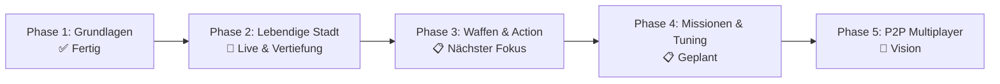

# GTA 7 — Entwicklungs-Roadmap 🗺️🚗💥

Dieses Dokument ist der Masterplan für **Matti**, seinen **Kumpel** und **Alexander**. Jedes Feature ist so aufgeteilt, dass es in kleinen, motivierenden Schritten programmiert, getestet und direkt im Browser gespielt werden kann.

---

## 📌 Übersicht der Entwicklungsphasen

---

## ✅ Phase 1: Fundament & Open-World-Setup (Abgeschlossen)
* [x] Three.js 3D-Rendering mit Schatten & physikalischem Antialiasing
* [x] Arcade-Fahrphysik mit Driften (Leertaste), Bremsen und Rückwärtsgang
* [x] Spielfigur zu Fuß steuerbar (WASD + Sprinten)
* [x] Verfolger- und Weitwinkel-Kamera mit dynamischem Zoom
* [x] 5-Sterne Fahndungssystem (⭐) mit Jagd-Polizeiwagen & Blinklichtern
* [x] City-Grid mit Straßenmarkierungen, Wolkenkratzern und Sprungschanzen
* [x] Cyber-HUD mit digitalem Tachometer, Schadensbalken und Minimap-Radar
* [x] Web Audio API Synthesizer (Motorensound, Hupe, Sirene, Crash)
* [x] Automatisierte GitHub Actions CI/CD Pipeline auf GitHub Pages

---

## 🚀 Phase 2: Lebendige Stadt, Ragdoll-Physik & Mobile Support (✅ Erledigt & Live)

| Meilenstein | Beschreibung | Status |
|---|---|---|
| **M2.1 Kalifornische Beleuchtung** | Frisches, klares Tageslicht mit blauem Himmel, warmen Sonnenstrahlen und scharfen Schatten für optimale Sicht | ✅ Erledigt |
| **M2.2 Ziviler Stadtverkehr (Traffic)** | Bunte NPC-Autos (Taxis, Limousinen, SUVs, Pickups), die auf den Straßen fahren, anhalten und gecrasht werden können | ✅ Erledigt |
| **M2.3 Passanten & Ballistische Ragdoll-Physik** | Passanten laufen auf Gehwegen; fährt man sie an, werden sie mit 3D-Ballistik katapultiert, rotieren in der Luft, federn am Boden ab und stehen wieder auf | ✅ Erledigt |
| **M2.4 Echtes Car-Jacking** | Der Spieler kann an JEDES vorbeifahrende Auto/Taxi herantreten, den Fahrer rauswerfen und den Wagen klauen (`E` / Mobile Icon) | ✅ Erledigt |
| **M2.5 Mobile Touch Steuerung** | Virtuelle Touch-Buttons für Smartphone & Tablet (Lenkungs-D-Pad, Gas, Bremse, Nitro, Schießen, Einsteigen, Hupe & Schnellzugriffsleiste) | ✅ Erledigt |

---

## 🔫 Phase 3: Waffen, Ballern & Pay 'n' Spray (✅ Erledigt & Live)

Ziel: Den Waffenladen mit echter Action füllen & Pay 'n' Spray Werkstatt einweihen!

| Meilenstein | Beschreibung | Status |
|---|---|---|
| **M3.1 Nahkampf & Faustschlag / Schläger** | Passanten und Autos per Mausklick / `F` mit Faust oder Baseballschläger demolieren | ✅ Erledigt |
| **M3.2 Pistole & Fadenkreuz** | Schnelle gelbe Leuchtspur-Projektile mit Mündungsfeuer, Waffensounds & Trefferschaden | ✅ Erledigt |
| **M3.3 Drive-by-Shooting** | Aus dem fahrenden Auto schießen und gegnerische Autos oder Streifenwagen beschießen | ✅ Erledigt |
| **M3.4 RPG Raketenwerfer & Explosionen** | Dicke Feuerball-Explosionen mit Stoßwelle, die Autos in die Luft schleudern | ✅ Erledigt |
| **M3.5 Pay 'n' Spray Werkstatt** | Grünes Werkstattgebäude in der Stadt: Reinfahren, umlackieren, 100% reparieren & alle Fahndungssterne loswerden | ✅ Erledigt |
| **M3.6 Schnellauswahl (1, 2, 3, 4)** | Sofortiger Waffenwechsel über die Zifferntasten `1` (Faust), `2` (Schläger), `3` (Pistole), `4` (RPG) | ✅ Erledigt |

---

## 🏆 Phase 4: Missionen, Tuning & Mini-Games (✅ Erledigt & Live)

Ziel: Mehr Missionen, Fahrgäste, Checkpoint-Rennen und Nitro-Speed!

| Meilenstein | Beschreibung | Status |
|---|---|---|
| **M4.1 Checkpoint-Straßenrennen** | Am leuchtenden Torbogen startet das Straßenrennen: 9 leuchtende Neon-Ringe quer durch die Stadt abfahren gegen die Zeit | ✅ Erledigt |
| **M4.2 Nitro-Boost (`N`-Taste / Shift)** | Zwillings-Flammenschweif aus den Auspuffrohren, Beschleunigung auf 245 km/h, leuchtende Unterbodenbeleuchtung | ✅ Erledigt |
| **M4.3 Stunt-Schanzen-Highscore** | Weitsprung- & Airtime-Erkennung an den Rampen: Jeder Meter Flugweite wird live auf dem Bildschirm prämiert und in Cash ausgezahlt | ✅ Erledigt |
| **M4.4 Interaktive Taxi-Fahrgäste** | Taste `J`: Passagier auf dem Bürgersteig abholen, zum grünen 3D-Leuchtstrahl fahren & Fahrpreis + Trinkgeld kassieren | ✅ Erledigt |

---

## 🌐 Phase 5: P2P WebRTC Multiplayer (✅ Erledigt & Live!)

Ziel: Wie in *Mattis Abenteuer* können Matti und sein Kumpel gemeinsam über das Internet in derselben Stadt rumfahren, Rennen fahren und sich gegenseitig rammen!

| Meilenstein | Beschreibung | Status |
|---|---|---|
| **M5.1 PeerJS WebRTC P2P** | Direkte Peer-to-Peer Verbindung ohne Serverkosten (Taste `P` öffnet Host / Join Menü mit 6-stelligem Code) | ✅ Erledigt |
| **M5.2 Synchronisierte Autos & Positionen** | Gegenseitiges Sehen der Autos in Echtzeit (Position, Heading, Lenkung, Räder & Nitro-Flammen) | ✅ Erledigt |
| **M5.3 3D Nametag & Minimap-Radar** | Schwebendes Namensschild `🎮 KUMPEL` über dem Wagen und pulsierender blauer Punkt auf dem Minimap-Radar | ✅ Erledigt |
| **M5.4 PvP Crash-Physik & Rammen** | Rammt man das Auto seines Kumpels mit hoher Geschwindigkeit, gibt es Crash-Sound, Schadensübertragung und Stoßwirkung | ✅ Erledigt |
| **M5.5 Synchronisiertes Ballern** | Schüsse und Raketen des Kumpels fliegen auch auf dem eigenen Bildschirm durch die Stadt | ✅ Erledigt |

---

## 🚁 Phase 6: Luft- & Wasser-Fahrzeuge & Custom Radio (Zukunftsausblick)

| Meilenstein | Beschreibung | Priorität |
|---|---|---|
| **M6.1 Fliegender Helikopter** | Hubschrauber auf dem Dach des höchsten Wolkenkratzers mit Rotorblatt-Animation & Höhensteuerung (`Shift`/`Strg`) | Hoch |
| **M6.2 Radio-Sender (GTA-Style)** | Umschaltbare Web-Radio-Stationen (Synthwave 80s, Hip-Hop Beats, Rock Radio) per Taste `R` | Hoch |
| **M6.3 Polizei-Helikopter bei 5 Sternen** | Verfolgungs-Helikopter der Polizei mit Suchscheinwerfer, der den Spieler von oben jagt | Mittel |

---

## 🌐 Phase 5: P2P WebRTC Multiplayer (Zusammen spielen!)

Ziel: Wie in *Mattis Abenteuer* können Matti und sein Kumpel gemeinsam über das Internet auf einem Server cruisen!

* **PeerJS WebRTC:** Direkte Peer-to-Peer Verbindung ohne teure Serverkosten.
* **Host / Join Menü:** Einer drückt auf "Spiel erstellen", gibt dem Kumpel den 5-stelligen Raumcode.
* **Gemeinsam zocken:** Synchronisierte Autos, gegenseitiges Rammen, Verfolgungsjagden und Polizei-Flucht zu zweit!

---

## 💡 Wie Matti & sein Kumpel ein neues Feature einbauen:
1. Feature aus der Roadmap aussuchen.
2. Branch erstellen: `git checkout -b feat/mein-feature`
3. Coden & lokal testen: `npm run dev`
4. Testen & Bauen: `make ci`
5. Pushen & PR erstellen: GitHub Actions aktualisiert die Live-Website automatisch!
