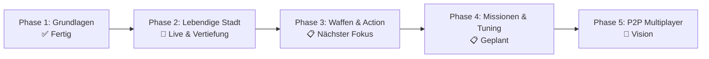

# GTA 7 — Entwicklungs-Roadmap 🗺️🚗💥

Dieses Dokument ist der Masterplan für **Matti**, seinen **Kumpel** und **Alexander**. Jedes Feature ist so aufgeteilt, dass es in kleinen, motivierenden Schritten programmiert, getestet und direkt im Browser gespielt werden kann.

---

## 📌 Übersicht der Entwicklungsphasen

---

## ✅ Phase 1: Fundament & Open-World-Setup (Abgeschlossen)
* [x] Three.js 3D-Rendering mit Schatten & physikalischem Antialiasing
* [x] Arcade-Fahrphysik mit Driften (Leertaste), Bremsen und Rückwärtsgang
* [x] Spielfigur zu Fuß steuerbar (WASD + Sprinten)
* [x] Verfolger- und Weitwinkel-Kamera mit dynamischem Zoom
* [x] 5-Sterne Fahndungssystem (⭐) mit Jagd-Polizeiwagen & Blinklichtern
* [x] City-Grid mit Straßenmarkierungen, Wolkenkratzern und Sprungschanzen
* [x] Cyber-HUD mit digitalem Tachometer, Schadensbalken und Minimap-Radar
* [x] Web Audio API Synthesizer (Motorensound, Hupe, Sirene, Crash)
* [x] Automatisierte GitHub Actions CI/CD Pipeline auf GitHub Pages

---

## 🚀 Phase 2: Lebendige Stadt & Gangster-Feeling (Aktuelle Phase)

| Meilenstein | Beschreibung | Status |
|---|---|---|
| **M2.1 Kalifornische Beleuchtung** | Frisches, klares Tageslicht mit blauem Himmel, warmen Sonnenstrahlen und scharfen Schatten für optimale Sicht | ✅ Erledigt |
| **M2.2 Ziviler Stadtverkehr (Traffic)** | Bunte NPC-Autos (Taxis, Limousinen, SUVs, Pickups), die auf den Straßen fahren, anhalten und gecrasht werden können | ✅ Erledigt |
| **M2.3 Passanten auf Gehwegen** | Zivilisten mit Geh-Animationen, die panisch ausweichen, wenn man hupt oder auf sie zurast | ✅ Erledigt |
| **M2.4 Echtes Car-Jacking** | Der Spieler kann an JEDES vorbeifahrende Auto/Taxi herantreten, den Fahrer rauswerfen und den Wagen klauen | ✅ Erledigt |
| **M2.5 Straßensperren & SWAT** | Bei 4 bis 5 Fahndungssternen errichten Polizisten Straßensperren quer über Kreuzungen | 📋 Next |
| **M2.6 Pay 'n' Spray Werkstatt** | Eine Lackierwerkstatt in der Stadt: Reinfahren, umlackieren und die Polizeisterne sofort loswerden | 📋 Next |

---

## 🔫 Phase 3: Waffen, Ballern & Pay 'n' Spray (✅ Erledigt & Live)

Ziel: Den Waffenladen mit echter Action füllen & Pay 'n' Spray Werkstatt einweihen!

| Meilenstein | Beschreibung | Status |
|---|---|---|
| **M3.1 Nahkampf & Faustschlag / Schläger** | Passanten und Autos per Mausklick / `F` mit Faust oder Baseballschläger demolieren | ✅ Erledigt |
| **M3.2 Pistole & Fadenkreuz** | Schnelle gelbe Leuchtspur-Projektile mit Mündungsfeuer, Waffensounds & Trefferschaden | ✅ Erledigt |
| **M3.3 Drive-by-Shooting** | Aus dem fahrenden Auto schießen und gegnerische Autos oder Streifenwagen beschießen | ✅ Erledigt |
| **M3.4 RPG Raketenwerfer & Explosionen** | Dicke Feuerball-Explosionen mit Stoßwelle, die Autos in die Luft schleudern | ✅ Erledigt |
| **M3.5 Pay 'n' Spray Werkstatt** | Grünes Werkstattgebäude in der Stadt: Reinfahren, umlackieren, 100% reparieren & alle Fahndungssterne loswerden | ✅ Erledigt |
| **M3.6 Schnellauswahl (1, 2, 3, 4)** | Sofortiger Waffenwechsel über die Zifferntasten `1` (Faust), `2` (Schläger), `3` (Pistole), `4` (RPG) | ✅ Erledigt |

---

## 🏆 Phase 4: Missionen, Tuning-Garage & Mini-Games (Nächste Phase)

Ziel: Mehr Missionen, Fahrgäste und noch krassere Tuning-Upgrades!

| Meilenstein | Beschreibung | Priorität |
|---|---|---|
| **M4.1 Echte Taxi-Fahrgäste** | Passanten winken am Straßenrand, steigen ins Taxi ein und man fährt sie zum Ziel für fettes Trinkgeld | Hoch |
| **M4.2 Stunt-Schanzen-Highscore** | Weitsprung-Messung bei den Schanzen: Jeder Meter Airtime wird live auf dem Bildschirm gezählt und bar ausgezahlt | Hoch |
| **M4.3 Checkpoint-Straßenrennen** | Rote Wegpunkte im City-Grid abfahren gegen die tickende Uhr mit Preisgeld | Hoch |
| **M4.4 Tuning-Werkstatt (Garage)** | Spoiler montieren, neonfarbene Unterbodenbeleuchtung, Nitro-Boost (Taste `N`) | Hoch |

---

## 🌐 Phase 5: P2P WebRTC Multiplayer (Zusammen spielen!)

Ziel: Wie in *Mattis Abenteuer* können Matti und sein Kumpel gemeinsam über das Internet auf einem Server cruisen!

* **PeerJS WebRTC:** Direkte Peer-to-Peer Verbindung ohne teure Serverkosten.
* **Host / Join Menü:** Einer drückt auf "Spiel erstellen", gibt dem Kumpel den 5-stelligen Raumcode.
* **Gemeinsam zocken:** Synchronisierte Autos, gegenseitiges Rammen, Verfolgungsjagden und Polizei-Flucht zu zweit!

---

## 💡 Wie Matti & sein Kumpel ein neues Feature einbauen:
1. Feature aus der Roadmap aussuchen.
2. Branch erstellen: `git checkout -b feat/mein-feature`
3. Coden & lokal testen: `npm run dev`
4. Testen & Bauen: `make ci`
5. Pushen & PR erstellen: GitHub Actions aktualisiert die Live-Website automatisch!
