# GTA 7 — Entwicklungs-Roadmap 🗺️🚗💥

Dieses Dokument ist der Masterplan für **Matti**, seinen **Kumpel** und **Alexander**. Jedes Feature ist so aufgeteilt, dass es in kleinen, motivierenden Schritten programmiert, getestet und direkt im Browser gespielt werden kann.

---

## 📌 Übersicht aller Entwicklungsphasen

```mermaid
flowchart TD
    subgraph Live["✅ Phasen 1-20 (Vollständig Implementiert & Live Spielbar!)"]
        L1["Phasen 1-4: Arcade-Fahrphysik, Ragdoll-Passanten, Waffen & Missionen"]
        L2["Phase 5: P2P WebRTC Multiplayer (Raumcode-System)"]
        L3["Phasen 6-7: DeLorean Flugmodus, Heli & GTA Cyber-Radio"]
        L4["Phasen 8-10: KI-Rennrivalen, Performance-Tuning & Nagelsperren"]
        L5["Phasen 11-12: Dynamischer Tag-Nacht-Zyklus, Wetter & Gang-Turf"]
        L6["Phase 13: Militärbasis Area 77, Rhino-Panzer, 6 Sterne & Cyber-Jetpack 🪖🚀"]
        L7["Phase 14: Diamond Cyber Casino, 3-Reel Slots & Tägliches Glücksrad 🎰🎡"]
        L8["Phase 15: Bankraub 'The Big Score' (Hacking, C4 Tresor & 5-Sterne-Flucht) 🏦💰"]
        L9["Phase 16: Ozean-Bucht, Wasser-Physik, Speedboot, Jet-Ski & Schmuggel 🚤🌊"]
        L10["Phase 17: Autonome Ring-U-Bahn, Unaufhaltsamer Güterzug & Tunnel 🚇🚆"]
        L11["Phase 18: Story-Kampagne mit 5 Kapiteln & Comic-Dialogen 🎬📖"]
        L12["Phase 19: Sandbox Stunt-Editor (Tab-Baumodus, Rampen, Loopings, Booster) 🏗️🎪"]
        L13["Phase 20: First-Person Cockpit-Ansicht (Taste C) & WebXR/VR-Support 🥽🕹️"]
        L1 --> L2 --> L3 --> L4 --> L5 --> L6 --> L7 --> L8 --> L9 --> L10 --> L11 --> L12 --> L13
    end
```

---

## ✅ Phase 1 bis 20: Vollständige Feature-Übersicht (Live & Spielbar!)

| Phase | Thema & Inhalt | Status |
|---|---|---|
| **Phase 1** | **Fundament & Fahrphysik**: Three.js 3D-Engine, Drift-Handling, 5-Sterne-Fahndung, Minimap & GitHub Actions CI/CD | ✅ Live |
| **Phase 2** | **Lebendige Stadt & Ragdoll**: Ziviler Verkehr, Passanten mit ballistischer 3D-Physik, echtes Car-Jacking & Mobile Touch-Steuerung | ✅ Live |
| **Phase 3** | **Waffen & Pay 'n' Spray**: Faustschlag, Baseballschläger, Pistole, RPG-Raketenwerfer, Explosionen & Werkstatt-Reparatur | ✅ Live |
| **Phase 4** | **Missionen & Stunt-Highscores**: 9-Checkpoint-Rennen, Nitro-Boost (245 km/h), Stunt-Airtime-Prämien & interaktive Taxi-Fahrgäste | ✅ Live |
| **Phase 5** | **P2P WebRTC Multiplayer**: Peer-to-Peer Direktverbindung ohne Serverkosten, synchronisierte Autos, PvP-Rammen & Schusswechsel | ✅ Live |
| **Phase 6** | **DeLorean DMC-12 & Next-Gen Grafik**: Edelstahl-Keil, klappbare Hover-Räder (BTTF Part II), Sky Dome, Palmen-Boulevards & Lichtkegel | ✅ Live |
| **Phase 7** | **Helikopter & GTA-Radio**: Fliegbarer Skyscraper-Heli, 4 Synthesizer-Radiosender, Polizei-Lufteinheit & SWAT-Straßensperren | ✅ Live |
| **Phase 8** | **KI-Straßenrenn-Rivalen**: 2 KI-Gegner (*Cyber Viper* & *Neon Phantom*), Überhol- & Rubberbanding-KI, Live-Podium-HUD & Preisgelder | ✅ Live |
| **Phase 9** | **Werkstatt-Tuning & Custom Shop**: Stage 1–3 Turbo (bis 280 km/h), Kevlar-Panzerung (-50% Schaden) & frei wählbare Neon-Unterbodenfarben | ✅ Live |
| **Phase 10** | **Polizei-Nagelsperren & PIT-Manöver**: 3D-Spike Strips, Reifenplatzer mit Funkenflug & Geschwindigkeitsdrosselung, aggressive PIT-Spins | ✅ Live |
| **Phase 11** | **Dynamischer Tag-Nacht-Zyklus & Cyber-Wetter**: Sonnen-Orbit, Dämmerung, Cyber-Nacht, volumetrischer Regen & Gewitterblitze (`L`/`K`) | ✅ Live |
| **Phase 12** | **Gang-Territorien & Kopfgeld-Konvoi**: Cyber Vipers vs Neon Syndicate, Gang-Patrouillen mit Drive-by & 300 HP SWAT-Boss ($5.000 Beute) | ✅ Live |
| **Phase 13** | **Militärbasis Area 77 & Rhino-Panzer**: 6. Fahndungsstern, 120mm Kanone, Wachtürme mit Suchscheinwerfern & Cyber-Jetpack (`J`) | ✅ Live |
| **Phase 14** | **Diamond Cyber Casino & Glücksrad**: 3-Walzen Cyber-Slots mit Jackpot-Multiplikatoren, tägliches Glücksrad & Casino-Hologramm | ✅ Live |
| **Phase 15** | **The Big Score Bankraub**: C4-Tresorsprengung, $25.000 Beute, 5-Sterne-Alarm & Flucht durch die Stadt | ✅ Live |
| **Phase 16** | **Harbor Ocean Bay & Wasser-Fahrzeuge**: Offshore Speedboot, Cyber Jet-Ski, Wellen-Auftriebsphysik & Schmuggel-Kisten | ✅ Live |
| **Phase 17** | **Ring-U-Bahn & Güterzug**: 3-teilige Cyber-Subway, unaufhaltsamer Güterzug mit Ramm-Wucht & Untergrund-Highway-Tunnel | ✅ Live |
| **Phase 18** | **Story-Kampagne**: 5 narrative Kapitel mit Comic-Dialogen, Belohnungen & dynamischer Missionsfortschritt | ✅ Live |
| **Phase 19** | **Sandbox Stunt-Editor**: In-Game Baumodus (`Tab`), Rampen, Loopings, 245 km/h Booster & JSON-Export | ✅ Live |
| **Phase 20** | **First-Person Cockpit & WebXR/VR**: Fahrersitz-Ego-Perspektive (`C` / `[🥽 VR]`), Armaturen-Blickwinkel & erweitertes Sichtfeld | ✅ Live |

---

## 🪖 Phase 13: Militärbasis, Kampfpanzer & Jet-Pack (Area 77)

Ziel: Den 6. Fahndungsstern einführen, die schwer bewachte Militärbasis am Stadtrand erobern und mit dem Rhino-Panzer und Jet-Pack für ultimatives Chaos sorgen!

| Meilenstein | Feature | Beschreibung | Technische Details |
|---|---|---|---|
| **M13.1** | **Sperrgebiet "Area 77"** | Streng bewachte Militärbasis am Stadtrand mit Wachtürmen, Stacheldrahtzäunen, Hangars und Scheinwerfern | Eigenes Distrikt-Areal am Stadt-Außenrand, automatischer 4-Sterne-Alarm beim Betreten |
| **M13.2** | **6. Fahndungsstern (⭐⭐⭐⭐⭐⭐)** | Wenn die normale Polizei überfordert ist, rückt die schwer bewaffnete Nationalgarde mit APCs und Panzern an | Neue Wanted-Stufe in `PoliceSystem.ts`, Militär-Trucks und schwere Durchbruchssperren |
| **M13.3** | **Steuerbarer Kampfpanzer (Rhino Tank)** | Massiver schwerer Kettenpanzer: 360° drehbarer Geschützturm (zielt mit Maus), Kanone feuert panzerbrechende Granaten, zermalmt normale Autos beim Überfahren | Panzer-Physik mit Kettenantriebs-Sound, extrem hoher Rammmasse und Explosionsgeschossen |
| **M13.4** | **Tragbares Cyber-Jet-Pack** | Taste `J`: Zu Fuß abheben, mit zwei blau-weißen Plasma-Flammen durch die Straßenschluchten zischen und auf Hausdächern landen | Höhen- & Richtungssteuerung, Treibstoffanzeige im HUD und automatischer Notschirm bei leerem Tank |

---

## 🎰 Phase 14: Diamond Cyber Casino, Minispiele & Nightlife

Ziel: Ein riesiges, glitzerndes Luxus-Casino mitten in Downtown, in dem Matti und sein Kumpel ihr erspieltes Geld vermehren oder verjubeln können!

| Meilenstein | Feature | Beschreibung | Technische Details |
|---|---|---|---|
| **M14.1** | **Casino-Wolkenkratzer & Luxus-Vorplatz** | Majestätisches Casino-Gebäude mit goldenen Säulen, gläserner Drehtür, Brunnen und rotem Teppich für Nobelkarossen | Detailreiches 3D-Gebäude mit animierter Leuchtreklame `DIAMOND CASINO` |
| **M14.2** | **Cyber-Spielautomaten (Slots)** | Einarmiger Bandit mit 3 Walzen: Kirschen, Bar, 777 und Diamanten. Einsätze von $10 bis $1.000, Mega-Jackpot bis $100.000! | Audio-Jingle mit Walzen-Dreh-Sound und Münzen-Klimpern bei Gewinnausschüttung |
| **M14.3** | **Tägliches Glücksrad (Lucky Wheel)** | Einmal pro Spielsession kostenlos am großen bunten Rad drehen: Gewinne Bargeld, Waffen, Spezial-Neon oder seltene Supercars | Physikalisches Dreh-Rad mit Bremswiderstand und Zeiger-Klick-Sound |
| **M14.4** | **Tiefgaragen-Showroom** | Unterirdische Tiefgarage des Casinos, in der alle gekauften Autos nebeneinander auf beleuchteten Drehtellern geparkt stehen | Begehbare Ausstellungsfläche mit Fahrzeugauswahl per Knopfdruck |

---

## 🏦 Phase 15: Großer Banküberfall (The Big Score Heist)

Ziel: Ein mehrstufiger, actiongeladener Bankraub à la GTA V, der taktische Planung, Hacking und eine spektakuläre Flucht erfordert!

| Meilenstein | Feature | Beschreibung | Technische Details |
|---|---|---|---|
| **M15.1** | **Vorbereitungsphase (Setup)** | Fluchtwagen in einer Seitengasse verstecken und C4-Sprengstoff im Waffenladen besorgen | Quest-System mit Waypoints und Checkliste im HUD |
| **M15.2** | **Infiltration & Hacking-Minispiel** | Bankfiliale betreten, Wachpersonal mit Taser ausschalten und Sicherheitskameras per Timing-Minispiel hacken | Interaktives 4x4-Gitter-Minispiel im HUD zur Überbrückung der Alarmanlage |
| **M15.3** | **Tresor-Sprengung & Beute-Raffung** | C4 an der schweren Stahltür platzieren, Zünder drücken, Tresorraum stürmen und $25.000 in Goldbarren einsacken | Partikelexplosion, fallende Geldbündel und steigender Bargeldzähler im HUD |
| **M15.4** | **5-Sterne-Flucht durch die City** | Sofortiger 5-Sterne-Polizeialarm! Flucht über U-Bahn-Schächte, Sprungschanzen oder per Fluchtwagen zur Pay 'n' Spray Werkstatt | Spezielle Flucht-Musik im Radio und Helikopter-Verfolgungsjagd |

---

## 🚤 Phase 16: Schiffsverkehr, Wasser-Physik & Jet-Skis (Ocean Drive)

Ziel: Die Stadt an ein lebendiges Gewässer anbinden mit spritziger Wasserphysik, Booten, Yachten und Jet-Skis!

| Meilenstein | Feature | Beschreibung | Technische Details |
|---|---|---|---|
| **M16.1** | **Wasser-Shader & Küstenlinie** | Blau schimmernde Bucht am Stadtrand mit Wellenbewegung, Sonnenreflexionen und Sandstränden | Three.js Wasser-Plane mit Sinus-Wellen-Displacement und Specular-Highlights |
| **M16.2** | **Steuerbares Speed-Boot & Luxus-Yacht** | Am Bootssteg anlegen, einsteigen und mit mächtiger Gischt über die Wellen jagen (`E` zum Einsteigen) | Auftriebs- & Wasserwiderstandsphysik, Bootsmotor-Sounds und weiße Heckwelle |
| **M16.3** | **Cyber Jet-Ski mit Stunt-Sprung** | Wendiges Jet-Ski für rasante 360°-Drifts auf dem Wasser und Sprünge über schwimmende Holzrampen | Agiles Lenkverhalten, Sprungerkennung und Splash-Partikeleffekte |
| **M16.4** | **See-Schmuggel-Missionen** | Im Boot auf das offene Meer hinausfahren, versunkene Schatztruhen bergen und vor Patrouillenbooten fliehen | Radar-Peilsender im HUD mit Tiefensensor und Beute-Belohnung |

---

## 🚇 Phase 17: U-Bahn, Güterzug & Untergrund-Highways

Ziel: Ein funktionierendes Schienennetz über und unter der Erde, das für atemberaubende Verfolgungsjagden und epische Crashs sorgt!

| Meilenstein | Feature | Beschreibung | Technische Details |
|---|---|---|---|
| **M17.1** | **Autonome Ring-U-Bahn (Subway)** | Hochmoderne Cyber-U-Bahn fährt auf Hochtrassen und in Tunnels durch alle Stadtteile; hält an Stationen | Automatischer Schienen-Pfad mit Ein-/Aussteigefunktion und Stationsansagen |
| **M17.2** | **Schwerer Güterzug (Unstoppable Train)** | Massiver, unaufhaltsamer Güterzug auf den Gleisen: Rammt man ihn, fliegen Autos physikalisch meterweit durch die Luft! | Unendliche Rammmasse, Kollisionsschockwelle und Zugsirene |
| **M17.3** | **Unterirdisches Tunnelsystem** | Verzweigte Tunnel unter den Wolkenkratzern für illegale Midnight-Rennen ohne störende Polizeihubschrauber | Neon-beleuchtete Tunnelröhren mit akustischem Hall-Effekt auf Auspuff- und Motorensounds |
| **M17.4** | **U-Bahn-Surfen & Dachkraxelei** | Zu Fuß auf das Dach fahrender U-Bahnen springen und während der Fahrt durch die Stadt surfen | Physik-Parenting des Spielers an den bewegten Zugwaggon |

---

## 🎬 Phase 18: Story-Kampagne ("Matti & Kumpel in Los Cyberos")

Ziel: Eine echte Storyline mit packenden Charakteren, Comic-Dialogen und spannenden Missionskapiteln!

| Meilenstein | Feature | Beschreibung | Technische Details |
|---|---|---|---|
| **M18.1** | **Kapitel-Struktur & Quest-Log** | Strukturierte Storyline von Kapitel 1 ("Der erste Schlitten") bis Kapitel 5 ("Die Herrscher der Stadt") | Quest-Tracker im HUD mit Hauptmissions- und Nebenauftrags-Markern |
| **M18.2** | **Comic-Zwischensequenzen** | Handgezeichnete / stilisierte Comic-Panels mit Sprechblasen und Soundeffekten vor Schlüsselmissionen | Leichtgewichtige 2D-Overlay-Cutscenes mit Typewriter-Texteffekt |
| **M18.3** | **Bosskämpfe mit Phasen** | Spezielle Missionsbosse mit Angriffsmustern (z. B. "Don Corleone im Kampfhubschrauber" oder "Syndicate-Hacker") | Dynamische Boss-Lebensleiste, Verstärkungswellen und Phasentransitionen |
| **M18.4** | **Freischaltbare Belohnungen** | Nach jedem Kapitel werden exklusive Spezialfahrzeuge, Waffen-Skins und Spieler-Kostüme freigeschaltet | Permanentes Speicher-System (LocalStorage) für Missionsfortschritt |

---

## 🏗️ Phase 19: Sandbox Stunt-Editor (Rampen, Loopings & Feuerringe)

Ziel: Matti und sein Kumpel können die Stadt in ihren eigenen ultimativen Stunt-Park verwandeln!

| Meilenstein | Feature | Beschreibung | Technische Details |
|---|---|---|---|
| **M19.1** | **In-Game Bau-Modus (Taste `Tab`)** | Wechselt in den schwebenden Architekten-Modus mit Raster-Vorschau und Bauteile-Katalog | Raycasting-Platzierungslogik mit Snapping an Straßen und Plätzen |
| **M19.2** | **Stunt-Bauteile-Katalog** | Mega-Sprungschanzen, Korkenzieher-Loopings, Nitro-Boost-Streifen, brennende Feuerringe und Domino-Kisten | Vorgefertigte 3D-Meshes mit präzisen Kollisionsboxen und Trigger-Funktionen |
| **M19.3** | **Strecken-Speicherung & Export** | Selbstgebaute Stunt-Tracks können mit einem Klick als JSON-Code kopiert oder lokal gespeichert werden | LocalStorage Persistenz und JSON-Export/Import im Pause-Menü |
| **M19.4** | **Multiplayer Stunt-Showdown** | Im Multiplayer sieht der Kumpel platzierte Rampen sofort live und kann direkt mit drüber heizen! | NetProtocol Erweiterung für Objekt-Spawn-Nachrichten |

---

## 🥽 Phase 20: First-Person Cockpit & WebXR/VR-Support

Ziel: Maximale Immersion! Matti setzt sich direkt ans Steuer oder taucht mit einer VR-Brille direkt in GTA 7 ein!

| Meilenstein | Feature | Beschreibung | Technische Details |
|---|---|---|---|
| **M19.1** | **Echte Cockpit-Innenansicht (Taste `C`)** | Detailliertes Armaturenbrett im Auto: Hände am Sportlenkrad, funktionierender Tacho, Drehzahlmesser & Rückspiegel | Interne Kamera-Positionierung im Fahrzeuginnenraum mit Kopfneigung bei Kurven |
| **M19.2** | **Cockpit-Details bei Regen & Nacht** | Regentropfen perlen an der Windschutzscheibe ab, Scheibenwischer wedeln, Cockpit-Armaturen glühen im Dunkeln | Transparente Glasscheiben mit Scheibenwischer-Animation und Interieur-Beleuchtung |
| **M19.3** | **WebXR VR-Modus** | Mit Meta Quest, Apple Vision oder Smartphone-VR-Brille die Stadt in echtem 3D-VR erleben | WebXR API Unterstützung in Three.js mit 6DOF-Head-Tracking und Controller-Steuerung |

---

## 📊 Zusammenfassung der Entwicklungs-Timeline

| Phase | Fokus | Highlights | Zielgruppe |
|---|---|---|---|
| **13** | 🪖 **Militär & Chaos** | Kampfpanzer Rhino, 6 Sterne, Jet-Pack, Area 77 | Action & Zerstörung |
| **14** | 🎰 **Casino & Reichtum** | Spielautomaten, Glücksrad, Tiefgaragen-Showroom | Wirtschaft & Sammeltrieb |
| **15** | 🏦 **Heists & Taktik** | Banküberfall, Hacking, Tresor-Sprengung | Kooperatives Teamplay |
| **16** | 🚤 **Wasser & Meer** | Speed-Boote, Jet-Ski, Wellenphysik, Schmuggel | Cruisen & Erkunden |
| **17** | 🚇 **U-Bahn & Gleise** | U-Bahn-Netz, Güterzug-Crashs, Untergrund-Highways | Highspeed-Rennen |
| **18** | 🎬 **Story-Kampagne** | Comic-Zwischensequenzen, Kapitel, Bosskämpfe | Story & Langzeitmotivation |
| **19** | 🏗️ **Stunt-Baukasten** | Eigener Rampen-Editor, Loopings, Track-Sharing | Kreativität & Bastelspaß |
| **20** | 🥽 **VR & Cockpit** | First-Person Dashboard, Lenkrad, WebXR-Brille | Ultimative Immersion |

---

## 💡 Wie Matti & sein Kumpel die nächsten Features umsetzen:
1. Gemeinsam eine Phase aus der Roadmap aussuchen (z. B. **Phase 13: Panzer & Jet-Pack** oder **Phase 14: Casino & Glücksrad**).
2. Entwicklungs-Branch anlegen: `git checkout -b feat/phase-13-panzer`
3. Coden & lokal testen: `npm run dev` (Vite Hot Reloading)
4. Qualität sichern: `npm test` & `npm run typecheck`
5. Pushen & Deployen: `git push origin main` — GitHub Actions aktualisiert das Live-Spiel in unter 40 Sekunden!
