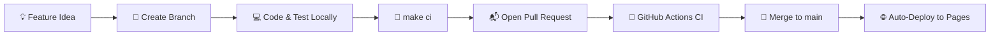

# Software Development Lifecycle (SDLC) — GTA 7 🚀

This document defines how Matti, his buddy, and mentors collaborate on GTA 7 with clean engineering practices.

---

## 1. Development Principles

1. **Keep It Playable**: The `main` branch must always remain playable and pass all automated tests and linter checks.
2. **Small, Exciting Iterations**: Build one cool feature at a time (e.g. adding nitro boost, adding a sports car spoiler, building a jump ramp) instead of massive refactors.
3. **Automated Verification**: Run `make ci` before pushing to guarantee nothing is broken.

---

## 2. Step-by-Step Workflow



### Step 1: Create a feature branch
```bash
git checkout main
git pull origin main
git checkout -b feat/my-cool-feature
```

### Step 2: Code and test in dev mode
```bash
npm run dev
```

### Step 3: Run full local CI
```bash
make ci
```
This runs ESLint, Vitest unit tests, and the TypeScript build check.

### Step 4: Commit and Push
```bash
git add .
git commit -m "feat(cars): add turbo nitro flames"
git push origin feat/my-cool-feature
```

### Step 5: Merge and Deploy
Once the PR is approved and green in GitHub Actions, merge to `main`.
GitHub Actions automatically builds and deploys to GitHub Pages in seconds!

---

## 3. Commit Message Convention

Use conventional commit prefixes:
- `feat:` New feature or gameplay element (e.g., `feat(audio): add 80s synthwave radio station`)
- `fix:` Bug fix (e.g., `fix(physics): prevent car from flipping through ground`)
- `docs:` Documentation change (e.g., `docs(prd): update planned vehicle roster`)
- `style:` Formatting or UI styling
- `test:` Adding or updating unit tests
- `chore:` Dependency or build tool updates
